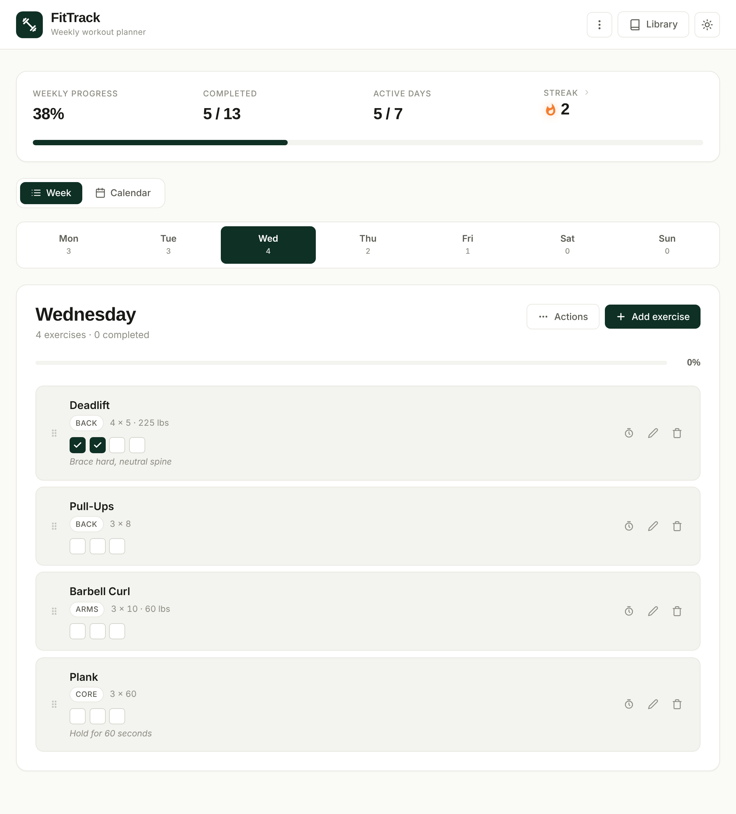
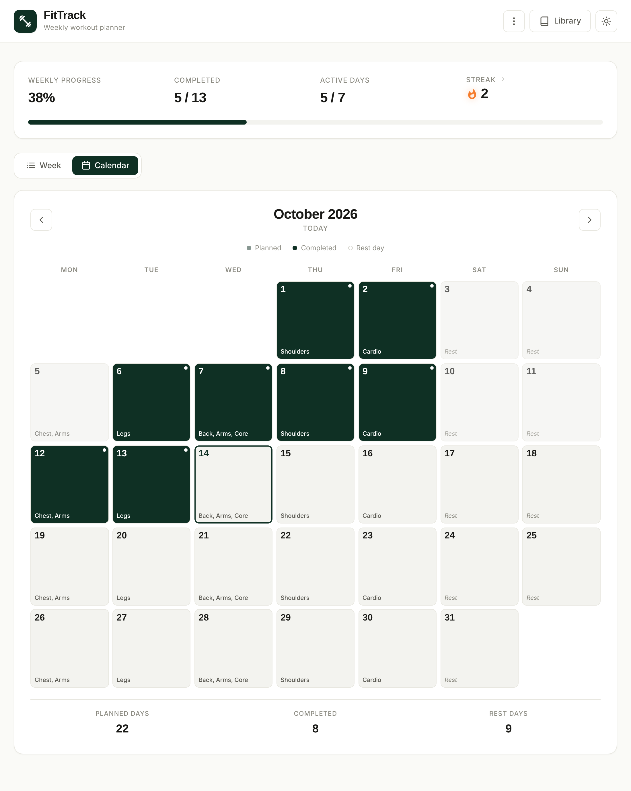
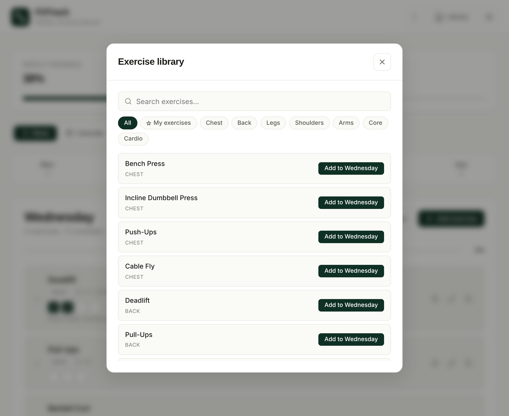
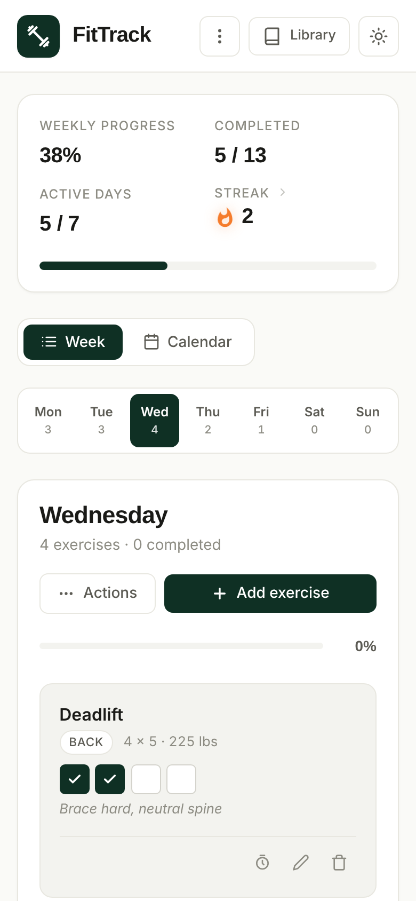

# FitTrack

A weekly workout planner that runs entirely in the browser. Plan exercises for each day of the week, check off sets as you go, rest between sets with a built-in timer, and track your streak over time.

Built with plain HTML, CSS, and JavaScript. No frameworks, no build step, no backend.

**Live demo:** https://samford-16.github.io/Workout-Manager/



## Features

- **Weekly planner** with a tab for each day and a progress bar for the day and the week
- **Per-set tracking.** Each exercise shows one checkbox per set, so you can log progress mid-workout
- **Rest timer** that starts automatically after each set, with 60s / 90s / 2 min / 3 min presets and audio cues
- **Exercise library** of about 30 common lifts and cardio, searchable and filterable by muscle group
- **Custom exercises** you can save to your own library and reuse on any day
- **Streaks and history**, including current and longest streak, a 12-week activity heatmap, and a recent activity log
- **Calendar view** showing the muscle groups planned for every day of the month and which days you completed
- **Drag and drop** to reorder exercises
- **Copy a day** to another day of the week
- **Export and import** your data as a JSON backup
- **Print** a single day or the full week as a checklist
- **Dark mode** and a mobile-friendly layout

| Calendar | Library | Mobile |
|---|---|---|
|  |  |  |

## Running it

Clone the repo and open `index.html` in any modern browser:

```bash
git clone https://github.com/Samford-16/Workout-Manager.git
cd Workout-Manager
open index.html        # macOS
# or just double-click index.html
```

## How data is stored

Everything is saved in your browser's `localStorage`. Nothing is sent to a server, and data stays on the device and browser you use. Use **Export data** from the menu to back it up or move it to another device.

## Project structure

```
index.html    Markup for the app, modals, and timer
style.css     Styles, light and dark themes, print and mobile layouts
script.js     App state, rendering, and event handling
screenshots/  Images used in this README
```

## License

[MIT](LICENSE)
